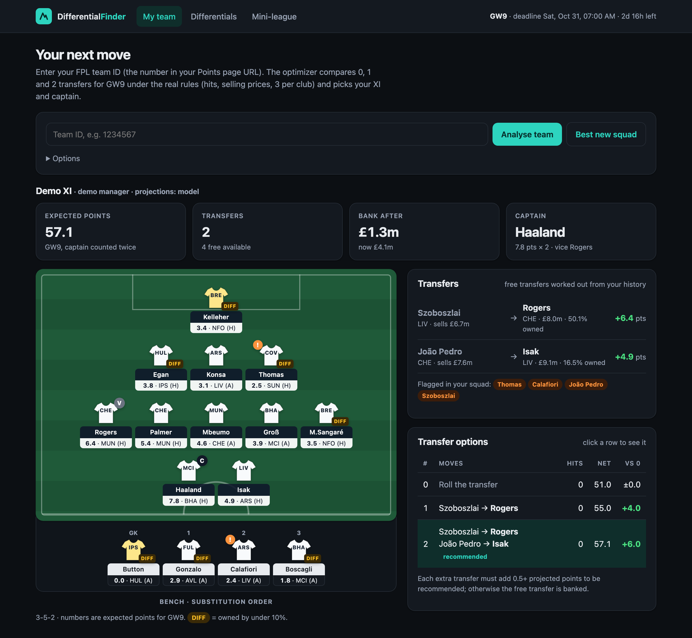
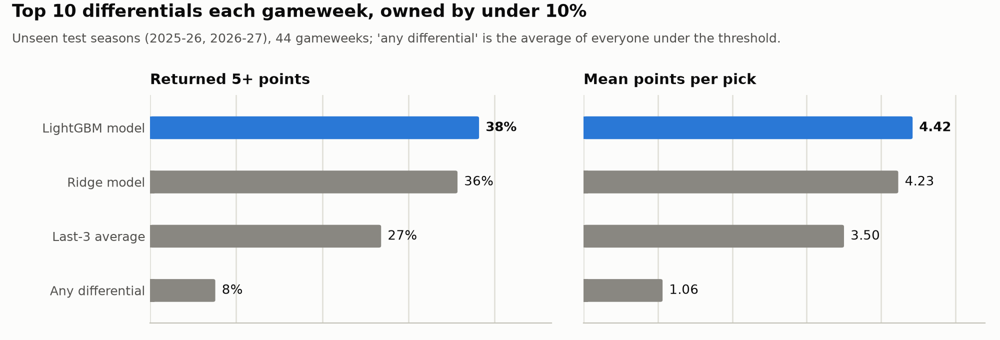
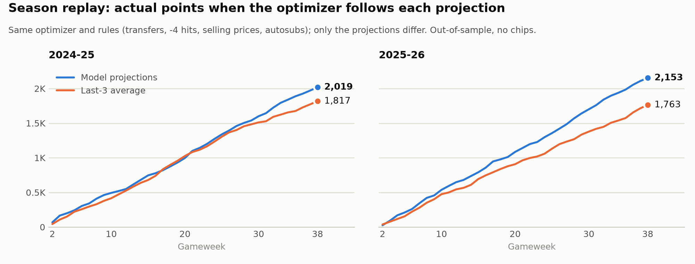
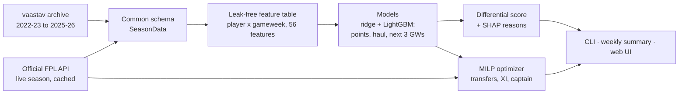
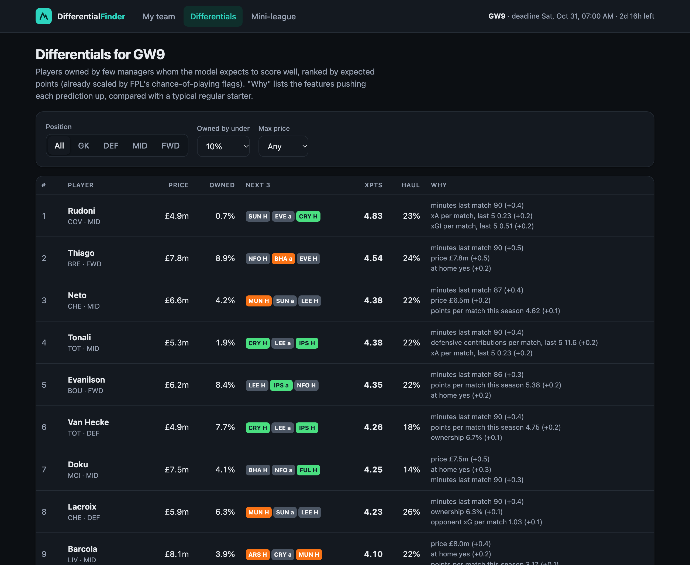
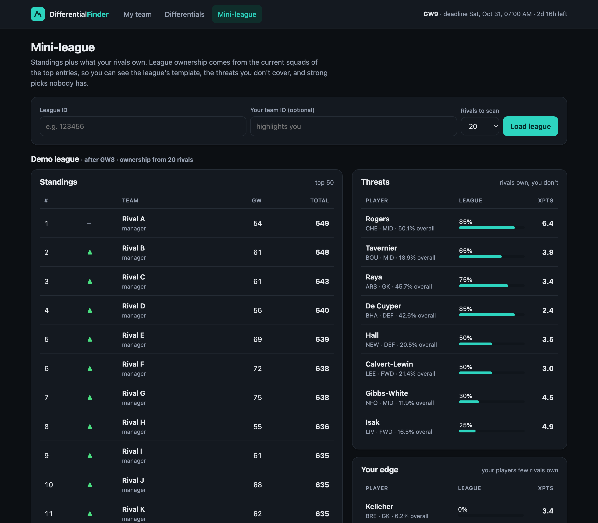
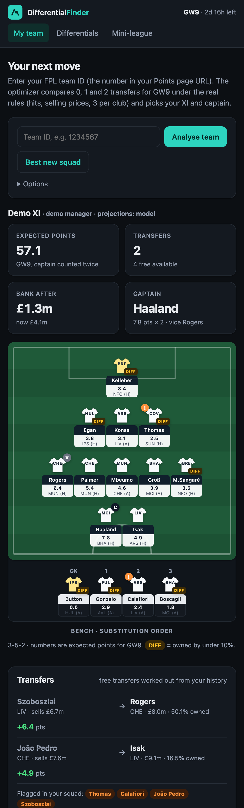

# FPL Differential Finder

**A machine-learning model that finds low-owned Fantasy Premier League players likely to score
well, with a transfer optimizer and web UI built on top of it.**



- **Finds differentials.** It ranks players owned by under 10% of managers by expected points and
  says why, using SHAP. On two seasons it never saw, its weekly top-10 differentials returned 5+
  points **38% of the time, against 27% for a form baseline**.
- **Plans your week.** A mixed-integer program uses the real rules (hits, selling prices, 3 per club)
  to pick transfers, the XI, the bench order and the captain for your team.
- **Proven in a replay.** Driving the optimizer with the model's projections scored **2,019 and 2,153
  points** across two replayed seasons, against **1,817 and 1,763** with the baseline's projections.

Python · pandas · scikit-learn · LightGBM · PuLP/HiGHS · FastAPI · plain HTML/JS · pytest.
It uses only free, public data: the official FPL API and the community
[vaastav/Fantasy-Premier-League](https://github.com/vaastav/Fantasy-Premier-League) archive.

---

## Contents

[Results](#results) · [Quick start](#quick-start) · [How it works](#how-it-works) ·
[Web UI](#web-ui) · [A finding about FPL's xP](#a-finding-fpls-historical-xp-is-look-ahead) ·
[Testing](#testing) · [Limitations](#limitations) · [Designed for later](#designed-for-later) ·
[Reference](#reference)

## Results

These figures are as of 2026-27 GW8. Every number below is **out-of-sample**: each season is
predicted only by models trained on earlier seasons. The differential-score settings were chosen on
2024-25, and **2025-26 and 2026-27 were never used for any decision**. Full write-ups:
[baselines](reports/phase1_baselines.md), [model](reports/phase2_model.md),
[backtest](reports/phase3_backtest.md).

<picture>
  <source media="(prefers-color-scheme: dark)" srcset="docs/images/differentials-dark.png">
  
</picture>

Results on the test seasons (2025-26 and 2026-27, 44 gameweeks):

| | Last-3 average | Ridge | **LightGBM** |
|---|---|---|---|
| Top-10 differentials returning 5+ pts | 26.8% | 35.7% | **38.2%** |
| Top-10 differentials hauling (8+) | 14.1% | 20.0% | **21.4%** |
| Points per differential pick | 3.50 | 4.23 | **4.42** |
| Points MAE, all players | 1.105 | 1.057 | **1.018** |
| Haul AUC | 0.825 | 0.855 | **0.860** |
| Next-3-gameweek points MAE | 2.73 | 2.40 | **2.34** |

**Is it real?** Paired by gameweek against the baseline's picks, LightGBM adds **+11.4 percentage
points** of return rate (95% CI +5.7 to +17.3) and **+0.92 points per pick** (+0.52 to +1.34). It
wins 64% of gameweeks and ties 18%. The gain shows up in every season: 2024-25, 2025-26 and 2026-27
so far.

<picture>
  <source media="(prefers-color-scheme: dark)" srcset="docs/images/backtest-dark.png">
  
</picture>

**Season replay.** The same optimizer and rules ran each week, with only the projections changed:

| | 2024-25 | 2025-26 |
|---|---|---|
| Model projections | **2,019 pts** · 3 hits | **2,153 pts** · 3 hits |
| Last-3 projections | 1,817 pts · 32 hits | 1,763 pts · 28 hits |
| Difference per gameweek (95% CI) | +5.5 (−1.9 to +12.4) | **+10.5 (+4.4 to +17.1)** |

The last-3 average promised about 83 points a week for the team it picked and delivered about 48.
Optimizing over noisy form keeps buying whoever is on a lucky streak, and pays for it in hits. The
model's projections for its own team were honest: 54 projected, 55-58 delivered.

**Where the gains are modest:**
- **General ranking.** For ranking *every* player, the model barely beats last-3 (Spearman 0.710
  against 0.703). Most of that is the easy part: who plays and who doesn't. The real gain is in the
  tail, picking which low-owned players return.
- **2024-25 replay.** The interval for the 2024-25 replay crosses zero.
- **Extra score terms.** Adding a haul-probability bonus, an "edge over what ownership implies"
  term, or a price penalty to the differential score all made dev results *worse*. Their weights
  are therefore 0, and the score is currently expected points among players owned by under 10%.

## Quick start

Requires Python 3.11+. On macOS, LightGBM also needs OpenMP (`brew install libomp`).

```bash
git clone <this repo> && cd fpl-optimizer
python3 -m venv .venv && .venv/bin/pip install -r requirements.txt -e .   # or: make setup
```

**The weekly command.** Run it before each deadline:

```bash
make weekly TEAM=1234567          # python -m fplopt weekly --team-id 1234567
```

It does everything in one go:
- downloads any missing history;
- refetches the live season;
- rebuilds the leak-free features;
- retrains, which takes about 40 seconds;
- predicts the next gameweek;
- plans your transfers;
- prints a summary and saves it to `data/weekly/gw<N>.md`, which stays out of git.

Running it before the deadline also archives FPL's pre-deadline `ep_next`, which a future honest
ep_next backtest needs. Useful flags are `--no-retrain` and `--cached`.

**The web UI:**

```bash
make serve                        # http://127.0.0.1:8000
```

To schedule the weekly command, add a cron entry such as
`0 8 * * 5 cd /path/to/fpl-optimizer && make weekly TEAM=1234567`. That runs it every Friday at
08:00, ahead of the usual Friday-evening or Saturday-morning deadline.

## How it works



### Data

- **History.** `download-history` pulls four files per season from a **pinned commit** of the
  vaastav archive and records SHA-256s in `MANIFEST.json`. Seasons 2022-23 onward are used, because
  they are the first with xG/xA.
- **Live data.** The current season comes from the official API: about 670 players' histories,
  fetched once and cached. Every response is stored with a `fetched_at` timestamp. If the network
  fails, the client falls back to a stale cache entry with a warning.
- **One schema.** Both sources are normalized into the same schema, so nothing downstream knows
  where a row came from. Players are linked across seasons by FPL's stable `code`.

### Features and the no-leakage rule

There is one row per player per gameweek (double gameweeks are summed). The 56 features are all
known **before** the gameweek:

| Group | Features |
|---|---|
| Form | 3- and 5-fixture averages of points, minutes, starts, goals, assists, xG, xA, xGI, bonus, BPS, clean sheets, defensive contributions; xG, xA and points per 90 |
| Availability | minutes last match, minutes trend, matches since last start, played last match |
| Market | price, price change, ownership %, ownership change, net transfers |
| Team | rolling xG for/against, goals, points, clean-sheet rate |
| Fixtures | fixtures this gameweek (doubles/blanks), home share, opponent strength this week and over the next 3 |

The rule is that **a feature for gameweek N uses only information from before N**. In practice:
- Every stat is computed as a "state after gameweek G", carried over gameweeks the player missed,
  then shifted by one gameweek.
- Price and ownership come from the previous gameweek's record.
- Opponent strength is calculated from results we already have, *not* from FPL's difficulty
  ratings, because the historical difficulty files are end-of-season snapshots.

The rule is **enforced by tests**. A perturbation test randomly rewrites every result, price and
ownership figure from gameweek N onwards. It then requires every feature up to N to be
bit-for-bit unchanged, on synthetic data and on real seasons. As a check that the test works, two
deliberately injected leaks each fail 14 of its 16 cases.

### The model

- **Targets.** Points next gameweek (regression), a **haul** of 8+ points (classifier), and points
  over the next 3 gameweeks.
- **Two model families.** Ridge and logistic regression (median imputation with missing-value
  flags, scaled features) and **LightGBM**, which handles missing values natively.
- **Validation is walk-forward by season.** Nothing is shuffled. The number of boosting rounds comes
  from early stopping on the *latest training* season.
- **Reproducible.** Settings come from a single [config](configs/config.yaml). The seed is fixed and
  LightGBM runs in deterministic mode, so two training runs produce byte-identical reports. Saved
  models carry a `meta.json` with the training seasons, package versions and data commit.
- **What drives it.** By mean |SHAP|, minutes in the last match matters most by a distance. Then come
  points per match this season, recent minutes, price and ownership. The market carries real
  signal.

### The differential score

```
score = expected points + w1·P(haul) + w2·(expected − market-implied points) − w3·price
        for players owned by fewer than 10% of managers (the threshold is configurable)
```

*Market-implied points* is what ownership, price, position and fixtures predict on their own. The
weights are chosen from a small grid by precision@10 on the dev season. All three currently come
out at 0, as described in Results. Each pick carries **three reasons**, taken from LightGBM's
TreeSHAP and measured against a typical regular starter. For example, *"xA per match, last 5 0.23
(+0.2)"*. Measuring against all players would put "plays 90 minutes" first on every starter's list.
Live predictions are scaled by FPL's chance-of-playing flag.

### The optimizer

A mixed-integer program (PuLP, solved by [HiGHS](https://highs.dev)) decides, for every player:
*in squad*, *starting* and *captain*.

```
maximise   XI points + captain's points again + 0.1 × bench points − 4 × hits
subject to 2 GK / 5 DEF / 5 MID / 3 FWD; at most 3 per club
           a legal XI (1 GK, 3-5 DEF, 2-5 MID, 1-3 FWD); captain in the XI
           spend on new players ≤ bank + selling prices of players sold
           hits ≥ transfers − free transfers
           no buying or starting players flagged out or under 75% to play
```

It plans the next gameweek only:
- **Transfer options.** It solves exactly 0, 1 and 2 transfers, at about 0.1s each. It recommends
  the fewest unless each extra transfer adds at least 0.5 projected points.
- **Swappable projections.** The source switches between `--projection model` and `ep_next`.
- **Differential bonus.** An optional `--differential-bonus` lifts low-owned players in the
  objective.

**Your real team, without logging in.** The public API doesn't expose selling prices, so they are
rebuilt:
- **Purchase prices** come from your transfer history, with Free Hit weeks excluded and transfers
  you've already made for the coming gameweek applied.
- **Selling prices** follow FPL's rule: you keep half of any rise, rounded down, and take every fall
  in full.
- **Free transfers** are replayed from your history, banking up to 5. Wildcard and Free Hit weeks
  keep saved transfers.

**The backtest** replays a season week by week under these rules. It scores actual points with
automatic substitutions and the vice-captain rule.

## Web UI

`make serve` runs a FastAPI app that serves a JSON API and a single-page frontend in plain HTML,
CSS and JS. There is no build step, and the page makes no external requests. It works at phone
width and follows the system's light or dark mode.

| Differentials | Mini-league |
|---|---|
|  |  |

- **My team** (top of this page). Shows expected points, the recommended transfers with projected
  gain and your selling price, and every 0/1/2-transfer option (click one to show it on the pitch).
  The XI appears on a pitch with captain/vice badges, injury flags and *DIFF* tags, and the bench is
  in substitution order. Options let you switch projections, add a differential bonus or override
  free transfers. **Best new squad** builds the best £100m squad from scratch.
- **Differentials.** Price, ownership, the next 3 fixtures, expected points, haul chance and the
  model's reasons. You can filter by position, ownership and price.
- **Mini-league.** Standings with rank movement, plus ownership across your rivals' squads: the
  league's template, **threats** (players they own and you don't), **your edge** (your players few
  rivals own), and **untapped** strong picks nobody has.

<details><summary>Phone layout</summary>


</details>

API: `GET /api/status`, `/api/team/{id}`, `/api/squad`, `/api/differentials`, `/api/league/{id}`.
Interactive docs are at `/docs`. Screenshots are regenerated with `scripts/screenshots.sh` in demo
mode, which hides team and manager names and IDs.

## A finding: FPL's historical xP is look-ahead

The obvious baseline is FPL's own projection (`ep_next`). The historical archive records it as `xP`,
but **records it after each gameweek**, when FPL's "form" input already includes that week's
points. Among players with no minutes in their previous 5 fixtures, the recorded xP averages
**2.6 for those who went on to haul and 0.35 for those who blanked**. A pre-deadline forecast can't
tell those groups apart.

As a "differential finder", the recorded xP returns 69% of the time at 7.6 points per pick, which no
honest model can match. So:
- **Last-3 is the main baseline.** The recorded xP is reported only as an optimistic upper reference.
- **Clean ep_next going forward.** The live pipeline archives the real pre-deadline `ep_next` every
  week. The backtest picks it up as a projection source once a season is covered.

**Other data problems handled:**
- **Missing xP.** xP was not captured in some gameweeks (all zeros), including most of 2025-26.
- **Late xG and starts.** FPL only started recording xG/xA and starts in 2022-23 gameweek 16.
- **Assistant managers.** The 2024-25 "assistant manager" pseudo-players are dropped.
- **Duplicate rows.** 2025-26 has duplicated player-fixture rows, which are removed.
- **Postponed gameweek.** 2022-23 has no gameweek 7.
- **Ownership %.** History stores ownership as counts, not percentages. The number of managers is
  estimated as total ownership ÷ 15 (every squad has 15 players), without ever looking at a later
  gameweek.

## Testing

```bash
make test        # 82 tests, ~7 seconds, no network
```

| Area | What is tested |
|---|---|
| **Leakage** | Perturbation tests for every gameweek on synthetic and real data. Every feature must react to past data, so the test can't pass vacuously. Live rows must match hindsight rows. Outcomes must never be features. |
| Features | Rolling windows across double and blank gameweeks and season boundaries; prices from the previous gameweek; ownership share; promoted-team priors; targets |
| Data | Assistant managers dropped, duplicates removed, unrecorded stats masked, manager-count estimate, pinned and idempotent downloads, API cache/TTL/fallback/snapshots |
| Models | Time-based folds; reproducible training; scrambling test-season outcomes leaves predictions unchanged; differential score and weight choice; SHAP reasons |
| **Optimizer** | Every squad rule; unavailable players; **transfer-hit maths**; budget from **selling prices**; free-transfer inference; recommendation threshold; autosubs and vice-captain; team rebuilt from public endpoints |
| Web and weekly | Every endpoint with a fake FPL client; clean 404/503 JSON errors; weekly step order; CLI; charts |

## Limitations

- **No historical injury flags.** FPL keeps no history of them, so the model learns availability
  from minutes. Live flags are applied as a multiplier, which partly double-counts.
- **Final fixture schedule.** Historical seasons use the final schedule. A double gameweek two weeks
  ahead may not have been announced at the time, which slightly flatters the next-3-gameweek
  features.
- **Defensive contributions.** These have only scored points since 2025-26, so the 2025-26 model was
  trained without them.
- **Simplified backtest.** No chips; transfers use the previous gameweek's price; GW1 is skipped.
- **Next gameweek only.** The optimizer doesn't value banking a transfer for a later double
  gameweek, beyond the 0.5-point threshold.
- **Inferred free transfers.** One-off FPL top-ups are not modelled. Override with
  `--free-transfers`.
- **Sampled mini-league ownership.** It comes from the top 10-50 rivals, at one API call each.
- **A short honest ep_next record.** It only starts in 2026-27 GW9.

## Designed for later

These aren't built yet, but the code has a place for each:

- **Chips** reuse the same solver:
  - **Wildcard:** `solve(pool)` with the budget set to bank + selling prices.
  - **Free Hit:** the same for one week, without carrying the squad forward.
  - **Bench Boost:** a bench weight of 1.
  - **Triple Captain:** a captain coefficient of 2.

  Choosing *when* to play them needs multi-week projections. The next-3-gameweek model already
  provides them.
- **Multi-gameweek planner:** the same constraints indexed by gameweek, linked by
  squad(t) = squad(t−1) + in(t) − out(t). Free transfers carry over between weeks as state, and
  projections are discounted over the horizon. `rules.py` and the solver's constraint blocks were
  written to be reused per period.
- **An honest ep_next comparison** turns on automatically once the weekly snapshots cover a season
  (`backtest.sources.ep_next`).

## Reference

| Command | Does |
|---|---|
| `python -m fplopt weekly [--team-id N]` | The weekly run (above) |
| `python -m fplopt serve` | Web UI on :8000 |
| `python -m fplopt optimize [--team-id N] [--projection model\|ep_next] [--differential-bonus 0.1]` | Transfers, XI and captain in the terminal (a new squad without `--team-id`) |
| `python -m fplopt predict [--top 10]` | Next-gameweek predictions and top differentials |
| `python -m fplopt train` | Walk-forward evaluation, final models, `reports/phase2_model.md` |
| `python -m fplopt backtest` | Season replay per projection source, `reports/phase3_backtest.md` |
| `python -m fplopt baselines` | `reports/phase1_baselines.md` |
| `python -m fplopt charts` | The README charts in `docs/images/` |
| `download-history`, `fetch-live`, `build-features` | The individual data steps |

```
configs/config.yaml      every setting: seasons, windows, thresholds, model, optimizer
src/fplopt/
  data/                  API client (timestamped cache), vaastav downloader, live season, schema
  features/              stacked tables and the leak-free feature builder
  models/                folds, ridge/LightGBM, differential score, SHAP reasons, report
  optimize/              rules, MILP solver, projection sources, team loader, backtest
  web/                   FastAPI app, page data, static/ frontend
  baselines.py, evaluate.py, charts.py, pipeline.py, cli.py
tests/                   82 tests (see Testing)
reports/                 generated evaluation write-ups (committed)
docs/images/             charts and screenshots
scripts/screenshots.sh   regenerate the screenshots
```

Data: the official Fantasy Premier League API and
[vaastav/Fantasy-Premier-League](https://github.com/vaastav/Fantasy-Premier-League). This is an
independent fan project and is not affiliated with the Premier League.
